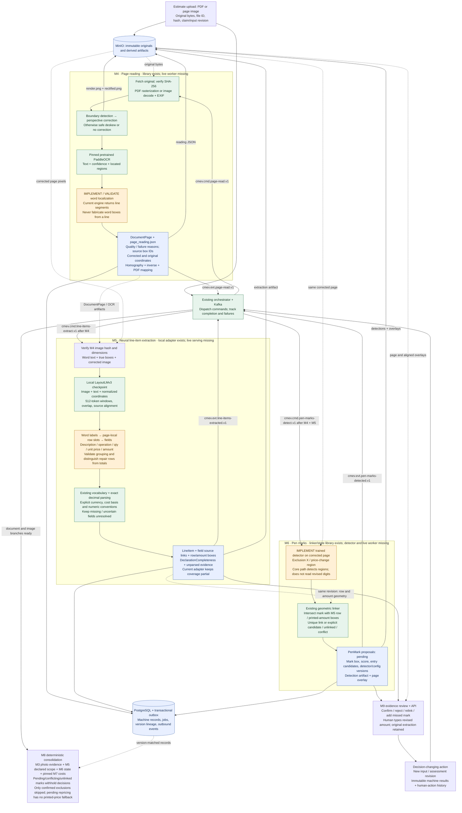

# Document worker implementation plan

Planning snapshot: 2026-10-11, Asia/Singapore, `document-worker` at `ec8bcba`.
This is a proposed implementation sequence, not a report of completed integration.
The user's intended neural M5 path is retained. Existing parser-based specifications
describe the earlier baseline; reconcile those sections as neural serving is implemented.

## Detailed module connections



Green denotes existing reusable components, not completed live integration.
Amber denotes a missing capability or an assembly policy needing validation.
Blue denotes exchanged/persisted evidence. All live module handlers still need wiring.
Dotted arrows are artifact/data dependencies; solid event arrows pass through the
orchestrator. M6 does not maintain its own cross-topic join.

## Implementation sequence and acceptance gates

| Step | Concrete work | Evidence required before moving on |
| --- | --- | --- |
| 1. Freeze document fixtures and geometry | Select supported estimate families and permitted real acceptance pages. Preserve claim-grouped splits. Inspect synthetic field labels and annotation text; add actual marked-page variants and detector labels. | Manifest/provenance, claim-level split checks, visible-label alignment and ground truth for rows, amounts and marks. |
| 2. Complete the M4-to-neural-M5 interface | Validate a true word-localization path on corrected pages; retain line evidence if useful without pretending it is word evidence. Pin OCR weights/config. Reuse raster, geometry and transform libraries. | Actual engine word granularity; text/amount accuracy on supported pages; inverse-transform round trips for photos and rotated/cropped PDFs; honest unreadable/partial outcomes. |
| 3. Serve M4 through existing runtime | Implement object-store reads/hash checks, deterministic artifacts, record persistence and completion events. Register handler with shared consumer/job/outbox infrastructure. Package pinned OCR dependencies and weights. | Upload-to-real-DocumentPage integration, multipage/partial failure handling, duplicate delivery, retry/DLQ and historical revision preservation. |
| 4. Validate and strengthen neural M5 | Reuse local LayoutLMv3 inference, first-subword alignment and overflow. Validate row-slot grouping, cross-window deduplication, wrapped descriptions, totals exclusion, field confidence and row/amount geometry. Keep exact currency/unit semantics. | Held-out field extraction, row association, amount exactness and omission recall; inspect failed examples. Until coverage is established, keep declaration partial. A successful inference is not an accuracy milestone. |
| 5. Serve M5 through existing runtime | Read persisted M4 records/images, validate pins and hashes, store shared line items/completeness and raw prediction artifacts, emit completion. Supply stable row and amount geometry to M6. | Real M4→M5 contract integration; long/multipage documents; absent/uncertain amounts; distinct repeated row IDs; no silent fallback to parser or empty-success output. |
| 6. Build M6 detection and integration | Prepare exclusion/price-change labels, fit and version a detector, measure false positives on unmarked and unrelated handwriting. Feed detections to the existing linker/state machine; persist proposals and overlays. | Per-class detection precision/recall, row-link accuracy, ambiguous/conflicting/unlinked cases and explicit page failures. Every new proposal starts pending. |
| 7. Finish review evidence and reassessment | Serve original/corrected pages and aligned row/mark overlays. Bind visible selection to stable IDs. Connect confirmation/rejection/relink/manual amount actions to revision handling. | Browser acceptance with real persisted artifacts; stale action rejection; original/printed/revised amounts separate; changed decisions create new assessments; frozen report matches review. |
| 8. Release the integrated document lane | Add explicit live-document producer selection and Compose services; remove fixture ownership only for selected stages. Validate M4→M5→M6→M8 end to end with the real image branch. | Startup fail-closed on missing weights/config; broker restart/replay; lean/full semantic parity in compatible environments; no skipped stage represented as passed; documented held-out limitations. |

Packaging constraint: the current vision extra requires Transformers 5 and
`document-model` requires Transformers 4. Use separate compatible worker images/environments
for the initial deployment. A single combined environment requires an explicitly
tested dependency reconciliation; do not assume the two extras can coexist.

## Worked review flow

```mermaid
sequenceDiagram
    participant O as Orchestrator
    participant P as M4 page reader
    participant L as M5 LayoutLMv3
    participant M as M6 detector/linker
    participant H as Surveyor + review API
    participant C as M8
    O->>P: Read revision R estimate
    P-->>O: Corrected pages, OCR boxes, quality, artifact references
    O->>L: Extract rows from revision R pages
    L-->>O: Entry E, printed amount SGD 980, row/amount boxes, partial coverage
    O->>M: Detect marks using R pages and R rows
    M-->>O: Price-change proposal linked to E, pending; no revised numeric value
    O->>C: Assess available evidence and pinned versions
    C-->>H: Withhold price decision while repricing is pending; preserve partial scope
    H->>H: Inspect page; confirm link; type SGD 850
    H->>O: Record decision-changing action and new input revision R+1
    O->>C: Assess matching revised inputs; reuse unchanged evidence when valid
    C-->>H: Keep printed 980 and effective 850 separate; scope remains partial until resolved
```

The synthetic generator currently draws field-value regions and handwriting-font
entries, not measured word OCR or a labelled exclusion/price-change detector dataset.
Random “Approved” remarks are generated text, not evidence of final approval.
It can support development fixtures but does not by itself close M4 alignment,
M5 real-page generalization or M6 mark training requirements.

## References

- [M4 specification](specs/module-04-page-reading.md)
- [M5 specification](specs/module-05-line-item-extraction.md)
- [M6 specification](specs/module-06-pen-mark-recognition.md)
- [Integration contracts](specs/integration_contracts.md)
- [Data contracts](specs/data_contracts.md)
- [Existing neural tensor workflow](document-neural-workflow.md)
- [Local LayoutLMv3 command](layoutlmv3_line_item_extraction.md)

Validation of this planning artifact: reviewed current source and specifications;
no inference, dataset regeneration, runtime deployment or model evaluation performed.
